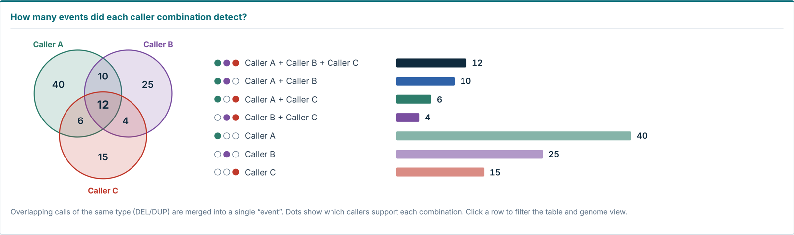

# CNVista

**Compare exome CNV calls from any number of callers in one offline HTML file.**
No server, no installation, no upload: files are read by your browser and never leave your computer,
so CNVista can be used on a hospital PC with patient data.

*Summary view with three illustrative call sets (Caller A, B and C; simulated calls, not real data): Venn diagram
and one bar per caller combination.*

> [!WARNING]
> **For research use only.** CNVista is a review tool for trained users, not a medical device and not intended for diagnostic use. It shows evidence; it does not
> classify CNVs. Confirm every finding with an orthogonal method before it enters a clinical report.

## Start

1. Download [`cnvista.html`](cnvista.html) (or the file from the latest release) and open it in
   Chrome, Edge, Firefox or Safari.
2. Drop your files, or a whole run folder, on the page. CNVista sorts them into groups by format and
   file name; you can drop a file onto a group, or change its group, caller name or role with the menus.
3. Explore the summary, the genome view and the event table; click an event, or type a locus or gene,
   to open the region view. **Download SVG** exports the region view for figures.

Not sure how your files should look? [`templates/`](templates/) holds an empty file for every input group, with the
expected header and a description of required and optional columns.

## What it shows

| Question | View |
|---|---|
| Which callers agree on this event? | Venn diagram (2–3 call sets) and one bar per caller combination (any number of call sets) |
| Where are the events? | Genome-wide ideogram (GRCh38 or GRCh37); duplications above, deletions below the line |
| Which events should I look at first? | Sortable, filterable event table: callers, size, targets, copy number, per-caller evidence, cohort z-score, ClinGen class, genes |
| Does the coverage support the call? | Region view: call bars per caller, the proband's log2-ratio and z-score tracks, the same tracks for parents, siblings and controls |
| Is this event common in our cohort? | Cohort heat map from a SEG file, with sample IDs hidden by default and the proband row highlighted |
| Is the allele balance consistent? | B-allele frequency panels from a small-variant VCF (proband and parents): heterozygous SNVs vanish in a deletion and shift to 0.33/0.67 in a duplication |
| Was it inherited? | With mother and/or father tracks: each event labelled *maternal*, *paternal*, *both* or *not seen in parents* (a coverage-based screen) |
| Is a dosage-sensitive gene involved? | Gene track with ClinGen haploinsufficiency score 3 genes highlighted |

## Input files

All files are text: tab-, comma- or semicolon-separated, or VCF (gzip is fine). Only call sets are required.

| Group | Formats | Notes |
|---|---|---|
| **Call sets** | TSV with `chrom/start/end` and `type` (or `cn`) columns · VCF with `<DEL>/<DUP>` · BED with a DEL/DUP column · CNVkit `.cns` · XHMM/CANOES `.xcnv` | Tested with ExomeDepth, CoNIFER and DRAGEN output; the GATK gCNV, CNVkit, XHMM, CANOES and CLAMMS layouts are read as well. Files with the same caller name are merged; multi-sample files offer a sample selector |
| **Coverage tracks** | bedGraph · CNVkit `.cnr` · GATK denoised copy ratios | Role from the file name: `proband`, `mother`, `father`, `sibling`, `control1`, `control2`… (Turkish `anne`, `baba`, `kardes`, `kontrol` also work) |
| **Variants (BAF)** | Small-variant VCF (`.vcf` / `.vcf.gz`), single-sample or joint trio | Biallelic SNVs, depth ≥ 10; allele depths from FORMAT `AD` (or `AF`, `RO`/`AO`); a role menu per sample |
| **Cohort** | SEG (`ID chrom loc.start loc.end num.mark seg.mean`) | Heat map in the region view |
| **Gene annotation** | BED: `chrom start end gene` | Gene track and search by gene symbol |
| **ClinGen dosage** | BED with a 5th column of haploinsufficiency scores (0–3, 30, 40) | Score-3 genes highlighted |

Column names, detection rules and every view are described in the [manual](docs/manual.md); empty templates are in
[`templates/`](templates/).

## Privacy

CNVista is a single HTML file with no external scripts, fonts or requests. Files are read with the
browser File API and kept in memory only; nothing is stored or sent when the tab is closed. The page
works from a local disk without a network connection. File names are not drawn in the plots, tracks
are labelled by role, and cohort sample IDs are hidden unless you choose to show them.

## Performance

On a laptop (Chromium), an exome with a few call sets and coverage tracks loads in a few seconds. A 164-MB cohort SEG
file (23 exomes × 193,000 targets) loads in 6–8 s and uses about 0.5 GB of browser memory.

## Limitations

Chromosome lengths are built in for GRCh38 and GRCh37 only. Overlapping calls are merged by
single-linkage, which can join adjacent but distinct events. Copy-number states on X and Y are not
inferred from CN alone. Parental labels use fixed coverage thresholds and do not replace segregation
testing. Very large SEG files are limited by browser memory.

## Development

CNVista was designed by a medical geneticist and written with the help of Anthropic's Claude models.
All code was reviewed and tested by the author. Bug reports and suggestions are welcome as GitHub
issues.

## Cite

Bahap Y. *CNVista: an offline browser tool for visual comparison of exome CNV calls from multiple
callers.* Version 0.3.2, 2026. See [`CITATION.cff`](CITATION.cff). A manuscript is in preparation.

## Licence

[MIT](LICENSE) © 2026 Yusuf Bahap, Department of Medical Genetics, Gazi University.
